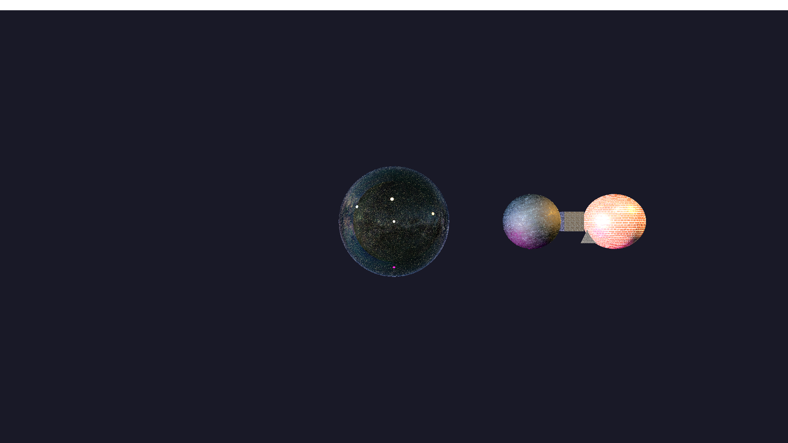

# 🪐 Computer Graphics

Rendering and 3D graphics projects from **EA979 at UNICAMP** 🇧🇷.

| Project | Focus |
| --- | --- |
| [01 · First Renderer](./01-first-renderer) | Rendering fundamentals and scene transformations |
| [02 · OpenGL](./02-opengl) | OpenGL rendering pipeline |
| [03 · Physically Based Rendering](./03-physically-based-rendering) | PBR, materials and lighting |
| [04 · Planetary Scene](./04-planetary-scene) | Animated planetary system with orbiting objects and textured surfaces |

**Stack:** Python · NumPy · OpenGL · Shaders · 3D Rendering

### 🌌 Final project preview

🎬 [Watch the rendered animation](./04-planetary-scene/minha_cena.mp4)

> The graphics projects include collaborative work. University starters, third-party assets and original contributors are credited in [SOURCES.md](./SOURCES.md).
